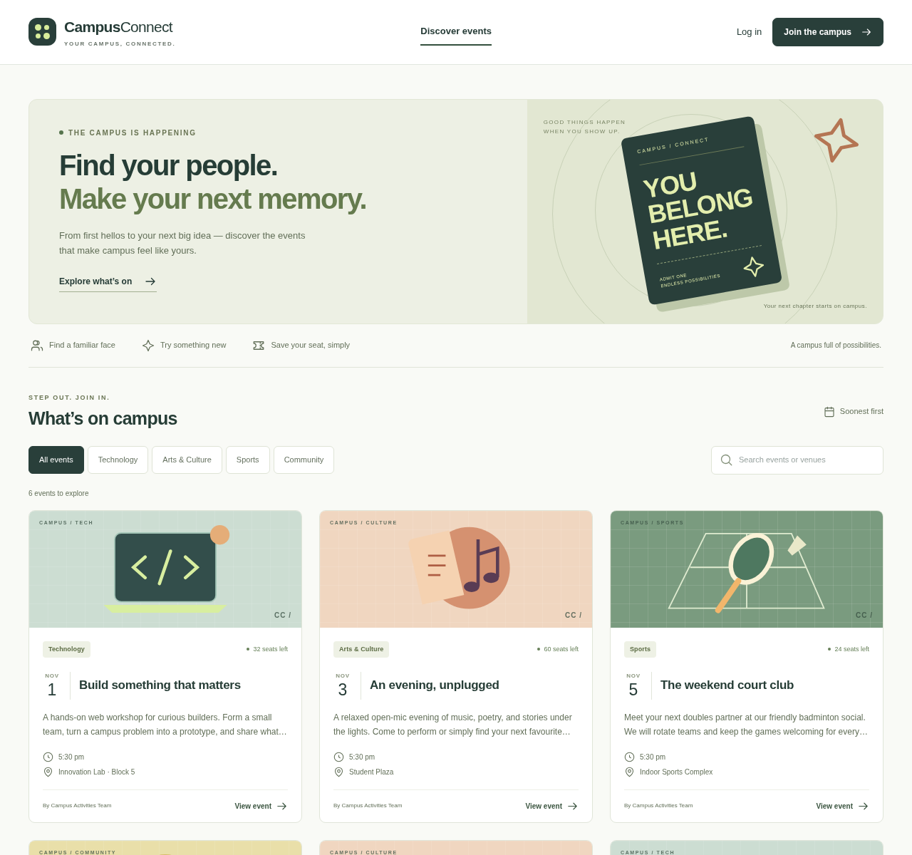
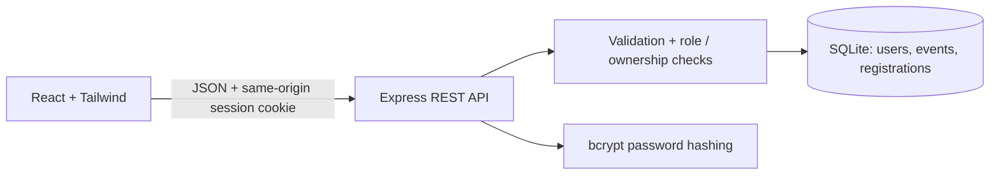
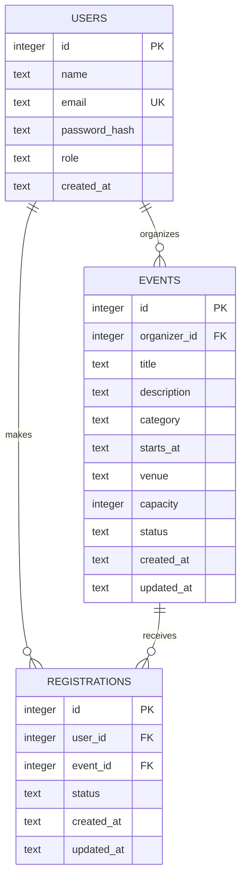
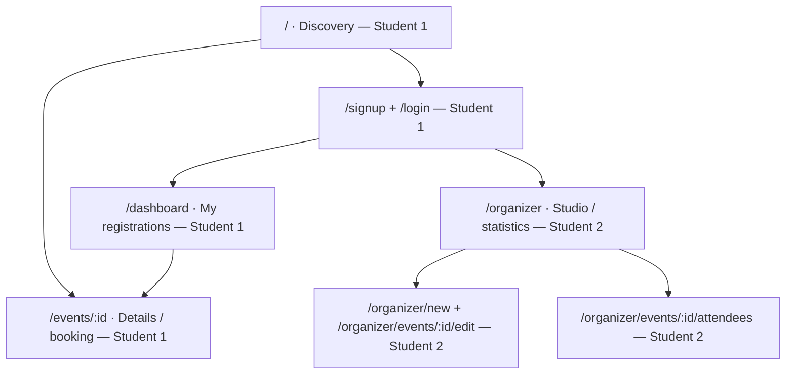

# CampusConnect

### Campus Event and Club Management Portal

Find your people. Make your next memory.

A small, full-stack Web Technology project for **FLEXICORE-3131, School of Computer Engineering, MIT Manipal**. Students discover events and manage their seats; organizers manage their own events and attendee lists. All six features use a real Express API and a persistent SQLite database.



## Six working features

| Feature | What you can demonstrate |
| --- | --- |
| 1. Accounts | Student signup, case-insensitive unique emails, bcrypt passwords, login, logout, protected endpoints |
| 2. Discovery | Database-driven events, title/description/venue search, category filters, chronological listing, empty states |
| 3. Event registration | Event details, live availability after booking, duplicate/full/closed/past-event rejection |
| 4. Student dashboard | Private registration history, confirmed/cancelled status, cancellation before the event starts |
| 5. Organizer management | Create, edit, close, and delete owned events; validate fields, future dates, and capacity |
| 6. Organizer dashboard | Owned-event totals, confirmed-registration statistics, private confirmed-attendee lists |

## Stack and architecture

**JavaScript throughout:** React 19, Vite 7, Tailwind CSS 4, React Router 7, Node.js 24, Express 5, SQLite, and bcrypt. ESLint checks source; Node's test runner exercises real HTTP endpoints; Playwright drives system Chromium.

Node 24's built-in `node:sqlite` driver replaces the optional Prisma ORM. Three small tables and one versioned migration do not require ORM generation or another native database dependency. Parameterized SQL keeps the data flow visible for classroom explanation. No Docker, paid APIs, external image/font services, or API keys are needed. Category illustrations are original local SVG components.



In development Vite proxies `/api` to Express. For the classroom demo, one Express process serves the Vite production build and API on one origin. No cross-origin API access is enabled.

## Prerequisites

- **Node.js 24.x** (includes SQLite) and npm.
- Git, for source control.
- Only for browser tests: Chromium, normally `/usr/bin/chromium`. Override with `CHROMIUM_PATH` if installed elsewhere. Alternatively install Playwright Chromium with `npx playwright install chromium` and set `CHROMIUM_PATH` to its executable.
- Only for regenerating reports: Python 3.10+, dependencies in `docs/requirements.txt`, and DejaVu fonts. The completed reports are already included.

## Install and run

From the repository root:

```sh
npm ci
npm run db:init
npm run db:seed
npm run build
npm start
```

Open the application on **port 3001**. `GET /api/health` must return `{"status":"ok"}`. No environment file is required. `.env.example` documents optional settings; to change them, copy it to an ignored `.env`. The project `.npmrc` uses a writable cache under `/tmp`, including in this cloud environment.

For live development, after initialization and seeding:

```sh
npm run dev
```

This starts Express on **3001** and Vite on **5173**. Open port **5173** for hot reload. Stop with Ctrl+C. You can also run `npm run dev:server` and `npm run dev:client` in separate terminals. Vite's proxy assumes the default backend port; update the proxy if you deliberately change it. Do not run the production and development backend on the same port simultaneously.

### Development demo accounts

**Fictional, public fixtures for local demonstration only.** Both accounts use the password `CampusDemo!24`.

| Role | Email |
| --- | --- |
| Student | `student@campus.demo` |
| Organizer | `organizer@campus.demo` |

Signup always creates a student, even if a request supplies a role. There is no public organizer signup or role switch. The seed script creates the single demo organizer explicitly. Do not seed a real deployment.

`db:init` applies schema version 1 via `PRAGMA user_version`; app startup also applies pending initialization. `db:seed` inserts six fictional events scheduled relative to the seed date. Both commands are repeatable: existing accounts, passwords, events, bookings, and edited events are preserved. Existing seed dates are not shifted by reruns. To start a fresh demo later, stop the server, back up your database, then remove the ignored `data/` directory and rerun initialization and seeding. This deliberately discards local demo data.

### Configuration

| Variable | Default | Purpose |
| --- | --- | --- |
| `PORT` | `3001` | Express listen port |
| `DATABASE_PATH` | `./data/campusconnect.sqlite` | SQLite file, relative to working directory |
| `COOKIE_SECURE` | `false` | Use `true` when serving through HTTPS |
| `APP_ORIGIN` | Inferred from request protocol + Host | Exact public origin if different behind a reverse proxy |
| `CHROMIUM_PATH` | `/usr/bin/chromium` | Browser test executable |

No secrets are required. The server loads `.env` if present; real environment variables take precedence. Keep SQLite files, cookies, and populated `.env` files out of Git. Before any public hosting, configure HTTPS, `COOKIE_SECURE=true`, and the exact `APP_ORIGIN`. Public hosting is outside this assignment's verified scope.

## Database and rules



`UNIQUE(user_id,event_id)` prevents duplicate registration rows. A cancelled registration is reactivated when the same student books again. Only `CONFIRMED` registrations consume capacity. Booking runs inside **`BEGIN IMMEDIATE`**, with the duplicate check, availability check, and write in the same transaction; SQLite serializes writers to prevent last-seat overbooking. A five-second busy timeout accommodates short competing writes. Capacity reductions use a transaction and cannot fall below confirmed bookings. These short transactions contain synchronous database work only, with no `await` between begin and commit.

Registration is allowed only for a student, before the event starts, while status is `OPEN`, and while capacity remains. Cancellation is allowed before the event starts, including when registration is closed. An organizer sees and manages only their own events. Deleting an event cascades its registrations; the UI asks for confirmation. All times are stored as UTC ISO strings and displayed in the viewer's local timezone.

## Pages and assigned team responsibilities



| Team member | Two primary modules for review and demonstration |
| --- | --- |
| **[STUDENT 1 NAME], [STUDENT 1 REGISTRATION NUMBER]** | Authentication & Student Dashboard; Event Discovery & Registration |
| **[STUDENT 2 NAME], [STUDENT 2 REGISTRATION NUMBER]** | Organizer Event Management; Organizer Dashboard & Attendee Management |

Shared responsibilities: architecture, schema, API integration, common design/navigation, integration tests, documentation, and report review. **This is an assigned demonstration/maintenance split, not a claim of historical individual authorship. The initial implementation and report were generated with Codex assistance. Both students must review, understand, adapt, and accurately acknowledge their actual contributions before submission.** Names, programme, registrations, guide, signatures, and submission month/year remain explicit placeholders.

Follow [the two-student demonstration guide](docs/DEMO.md) for a short classroom walkthrough.

## REST API

Successful responses are JSON objects (`user`, `events`, `event`, `registration`, `registrations`, or `attendees`). Errors consistently use `{"error":"Useful message"}`. Writes use `Content-Type: application/json` except bodyless DELETE. Cookies are sent by the browser automatically.

| Method | Path under `/api` | Access / result |
| --- | --- | --- |
| GET | `/health` | Database readiness |
| GET | `/auth/me` | Current safe user or `null` |
| POST | `/auth/register`, `/auth/login`, `/auth/logout` | Student signup, session creation, session invalidation |
| GET | `/events?search=...&category=...` | Public listing, optional filters |
| GET | `/events/:id` | Public details; own registration if signed in |
| POST | `/events/:id/register` | Student booking |
| GET | `/registrations` | Current student's registrations only |
| DELETE | `/registrations/:id` | Cancel own eligible registration |
| GET, POST | `/organizer/events` | List own events / create |
| PUT, DELETE | `/organizer/events/:id` | Update / delete own event |
| GET | `/organizer/events/:id/attendees` | Own event's confirmed students only |

Typical statuses: **200** success, **201** created, **400** validation, **401** login required / invalid credentials, **403** role, owner, or origin rejection, **404** absent resource (including another student's private registration), **409** duplicate / unavailable booking or invalid capacity reduction, **415** wrong body format, **429** auth rate limit, **500** unexpected failure without internal details.

## Testing and verification

```sh
npm run check          # ESLint, 20 HTTP integration tests, production build
npm run test:browser   # 10 Chromium walkthrough steps + genuine screenshots
npm audit             # dependency advisory check
```

There is no separate TypeScript check because the entire project uses JavaScript. Browser tests require an existing build (`npm run build`). API tests create a temporary SQLite file and listen on an ephemeral port. Browser tests seed a separate temporary database, start a server on **3101**, and close it afterwards. They do not alter your normal development database. Screenshots under `docs/screenshots/` are deliberately refreshed by the browser test.

A separate clean source copy also passed `npm ci`, repeated migration/seeding, build, startup, six-event retrieval, demo login, and the Vite proxy smoke check.

Verified on Node 24 with system Chromium: **20/20 API tests; 10/10 browser steps; ESLint and build passed; zero npm audit advisories at verification time**. The browser script checks for unexpected console errors and server exceptions. See [the test evidence and limitations](docs/TESTING.md). No Lighthouse score, public deployment, or independent security audit is claimed.

## Submission documents

- [Editable MIT Manipal report](docs/CampusConnect_Project_Report.docx)
- [PDF reading copy](docs/CampusConnect_Project_Report.pdf)
- [Classroom demo scripts](docs/DEMO.md)
- [Verification record](docs/TESTING.md)
- Original source template: `FullName_RegNo_WT_ProjectReport_ICT3131.docx`, preserved unchanged.
- Genuine browser screenshots: `docs/screenshots/`.

The Word report fills the provided template, retains its institutional images and required headings (including the repeated **1.5**), and uses placeholders for unknown academic details. The PDF is generated from the completed Word content with ReportLab; pagination differs from Word. Before submission, complete the placeholders and reconfirm the actual contribution statement. After editing Word, regenerate the PDF using the report script's `--pdf-only` option to keep the copies synchronized.

To regenerate documents (optional; does not run the app):

```sh
python3 -m venv /tmp/campusconnect-docs
/tmp/campusconnect-docs/bin/pip install -r docs/requirements.txt
/tmp/campusconnect-docs/bin/python scripts/generate_report.py
# Preserve manual Word edits while refreshing its PDF copy:
/tmp/campusconnect-docs/bin/python scripts/generate_report.py --pdf-only
```

## Security and scope limitations

Passwords use bcrypt cost 12 (8+ characters, at most 72 UTF-8 bytes). Sessions use random 256-bit opaque tokens in HttpOnly, SameSite=Lax cookies, expire after eight hours, and are kept in server memory. **Restarting the server logs everyone out**; users, events, and registrations remain in SQLite. Same-origin writes, JSON-only POST/PUT, input size limits, prepared SQL, role and owner checks, auth rate limiting, basic security headers, and a production Content Security Policy are implemented. User content is rendered as React text.

This is a single-process classroom application, not a production security audit. It has no password recovery, email verification, multi-process shared sessions, administrative account provisioning UI, or public deployment configuration. Authentication throttling is in memory (40 signup/login attempts per IP per 15 minutes); a shared classroom IP counts together. A browser session that expires requires logging in again. Attendee lists show only confirmed registrations; there are no emails, notifications, payments, analytics, or fabricated club records.

## Source

Repository: **https://github.com/loded-diper/FC-FINAL-PROJECT** (the configured Git origin).

```text
src/                 React pages, shared components, Tailwind + shared CSS
server/              REST routes, validation, SQLite migration, seed
tests/              Focused API and Chromium checks
scripts/             Dev launcher and report generation
docs/               Editable report, PDF, screenshots, demo and test records
```
